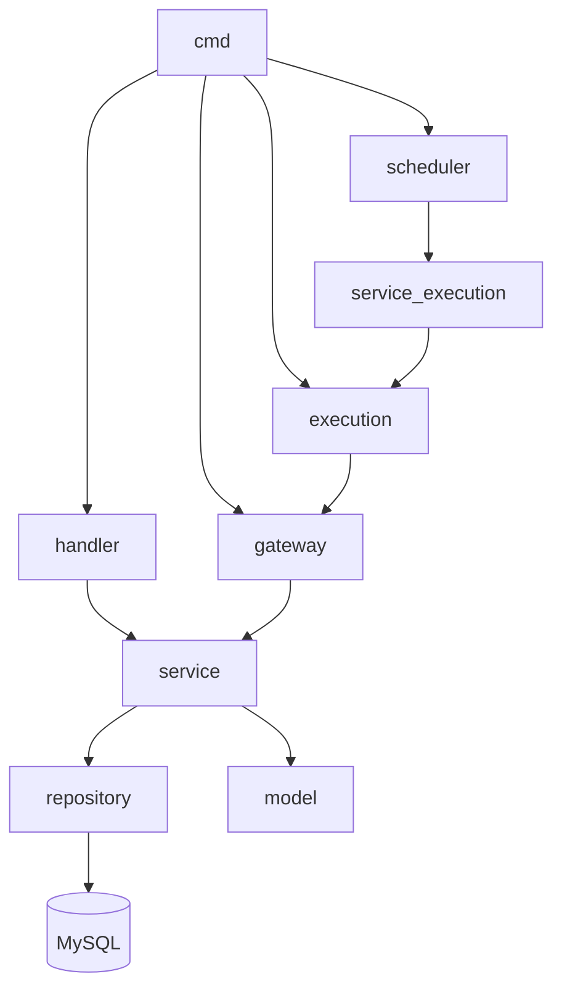

# Job Center 项目目录与组件（定稿）

按业界通用 Go 布局落地 job-center 单体；`schedules` 存 Cron 定义，新增 `schedule_triggers` 存预生成触发点；Gin Admin 优先。

## 目标

在 `job-center` 初始化标准 Go 单体工程：

- 进程内模块：Admin（Gin）、Gateway（WebSocket）、Scheduler、Execution
- 分层：`handler` → `service` → `repository`，模型在 `model`
- 表结构：`migrations/000001_init.sql`（未发版单文件合并）
- 模块路径：`github.com/GlassJob/job-center`
- Admin API（Phase A）+ Executor **WS Gateway 协议 1.1** + Task/Cancel MVP + Go SDK（`job-executor-go/`）+ Scheduler + WS 断线续跑已落地

## 目录结构

```text
job-center/
├── cmd/server/main.go
├── configs/config.example.yaml
├── migrations/          # 000001_init、embed.go
├── api/                 # 可选 OpenAPI（后置）
├── pkg/protocol/        # 可被 executor SDK 引用 + JSON Schema
├── internal/
│   ├── config/
│   ├── model/           # client/job/schedule/instance/execution…
│   ├── repository/mysql/
│   ├── service/         # 业务用例（含 execution 创建/取消入口）
│   ├── handler/         # Gin + middleware + admin/*
│   ├── gateway/         # Executor WebSocket（协议 1.1）
│   ├── scheduler/       # Cron 骨架
│   ├── execution/       # 状态机/租约/重试骨架
│   └── pkg/             # database、auth、log、idgen、clock
├── test/integration/
├── deployments/
├── scripts/
├── docs/
├── go.mod
├── Makefile
├── Dockerfile
└── README.md
```

## 依赖规则



- Handler 不写 SQL、不实现重试策略
- Gateway 不依赖 Gin；Scheduler 不执行业务代码
- 所有触发执行走 `service/execution`（HTTP/Cron/将来 API 同源）
- CRUD 保持薄：`handler → service 一方法 → repository`，不为每个动作堆空文件

## 开源组件

- Gin + validator
- GORM + `go-sql-driver/mysql`：Admin CRUD 用 GORM；调度/租约/SKIP LOCKED 等走 `Raw`/`Exec`
- Viper、slog、google/uuid（v7）、robfig/cron/v3（6 字段秒）、jsonschema/v6
- 迁移：golang-migrate + embed SQL，启动 MigrateUp（不用 GORM AutoMigrate）
- coder/websocket（Executor Gateway）
- 后置：Prometheus、OpenAPI

## Admin 鉴权（已定）

- `X-JC-Client-Id` = `clients.id`（UUID v7）
- Timestamp / Nonce / Operator 进入 HMAC canonical
- 写操作记 `operation_audits`

## 数据模型补充：`schedules` + `schedule_triggers`

定义与「待触发队列」分离，比只在 `schedules.next_fire_at` 上滚动更适合多节点抢锁、misfire/CATCH_UP 与可观测。

| 表 | 职责 |
|----|------|
| `schedules` | Cron/时区/策略/启停等**定义**；可保留 `horizon_at`（已预生成到何时）作水位 |
| `schedule_triggers` | 按 Cron **提前物化**的具体触发点（一行一次计划开火） |


### `schedule_triggers` 字段要点

- `id` CHAR(36) UUID v7 PK
- `schedule_id` / `job_id`（job_id 冗余便于查询）
- `fire_at` DATETIME(3) UTC 计划开火时间
- `status`：`PENDING` | `CLAIMED` | `FIRED` | `SKIPPED` | `CANCELLED`
- `claimed_by` / `claimed_at` / `claim_until`（多节点租约抢占）
- `execution_id` 可空（FIRED 后回写）
- `skip_reason` 可空
- **UNIQUE(`schedule_id`, `fire_at`)** — 替代仅靠 execution 上 `uk_schedule_tick` 做计划去重的主路径
- 索引：`(status, fire_at)` 供 due 扫描；`FOR UPDATE SKIP LOCKED` 领取

### `schedules` 调整

- 继续存：`cron_expression`、`timezone`、`enabled`、策略字段、`config_source`、`version`
- `next_fire_at` / `last_fire_at`：**可降级为展示缓存**，或改为 `horizon_at`（生成器已写到的时间）+ `last_fired_at`
- Admin 改 Cron/禁用时：删除 now 之后的 `PENDING`（及占 `uk_schedule_fire` 的 `CLAIMED`/`CANCELLED`），清空 `horizon_at`，再按新定义插入

### 与 `executions` 的关系

- 触发执行时：claim trigger → `service/execution` 创建 execution（可带 `schedule_id` + `scheduled_at=fire_at`）→ trigger 置 `FIRED`
- 仍可保留 execution 上 `(schedule_id, scheduled_at)` 唯一约束作双保险
- 手动/API 触发**不写** `schedule_triggers`（或 `schedule_id` 为空）

### 落地状态

- 表结构：`schedules.horizon_at` + `schedule_triggers` 已含于 `000001_init`
- 进程内 `internal/scheduler`：Generate（默认 horizon 7d、日扫；Create/改 cron·时区/启用立即预生成并 WakeClaim）→ Claim（有 PENDING 睡到 fire−`claim_lead`；无 PENDING 只等 WakeClaim，不轮询扫库；SKIP LOCKED → `CronTrigger`；无 ONLINE 直接 FAILED，有 ONLINE 无空位则 QUEUED）→ QueuedScanner（扫 `executions.QUEUED` 补派）
- Admin 管 `schedules` 定义；改 cron/timezone/禁用或删除时对未来触点先删再插并清空 `horizon_at`
- Admin triggers：**只读**全局/单排班列表；手动 `regenerate`（单排班 + 全平台先删再插）；日扫仍为增量补水位

### WS 容错验收要点

1. 长任务运行中断开 WS（不断执行器进程）→ handler 继续 → 重连后同一 `attempt_id` 可 `completed`。
2. 先停 Center，等任务本地跑完，再启 Center → pending 重放，中心进入终态。
3. 任务跑完后、ack 前重启执行器 → 磁盘 pending 启动后仍能补报。

## 已交付 / 下阶段

已交付：

1. go.mod + 标准目录 + `internal/pkg`
2. migrations embed + 启动迁移（`service_credentials.secret_enc` / `allowed_ips`）
3. Admin HMAC + health
4. Phase A Admin：clients / services / credentials / jobs / schedules / states / audits
5. **Executor WS Gateway 1.1**（HMAC + IP 白名单 + 注册/心跳/注销 + 调度策略 C）
6. 接口文档：`docs/api.md`、`docs/protocol-websocket-v1.1.md`

已补充：

- Task 执行 MVP（Admin 手动触发 + `task.execute`/`completed` 闭环）
- Admin Cancel + `task.cancel*` + attempt.`cancel_state`
- Go SDK：`../job-executor-go`（HMAC 1.1 + execute/cancel）
- **Scheduler**：`schedule_triggers` + HorizonGenerator / DueClaimer / QueuedScanner；`CronTrigger` + `DispatchQueued`；Patch/Delete 与 Admin regenerate（单/全）先删再插；triggers 只读列表
- **WS 断线续跑**：同 attempt 不随断线取消；`task.sync_running` + 心跳续租；终态本地 pending 必达；晚到终态可收口
- **执行日志落库**：SDK `job.Log` → `task.log`；`execution_logs` + attempt `log_*_collected`/`log_*_dropped`；`log_warn/error_count` 虚拟列

下阶段：

- 租约 LOST 扫描重派 / `CANCEL_UNCONFIRMED` 回收
- 完整 CATCH_UP 多火
- 可选 mTLS / 短期 session token / 节点级授权
- Prometheus、OpenAPI、Makefile/Dockerfile 完善

## 不做（当前阶段）

- 不拆微服务
- protocol 不放 internal（放 `pkg/protocol`）
- 不引入 Redis / Kafka；不启用 GORM AutoMigrate
- Admin 不暴露 triggers 写接口（无手动改触点）；只读列表 + regenerate 已交付
